# Per Ankh — Middle Egyptian

An Android app for learning to read Middle Egyptian hieroglyphs: signs, sounds, words, grammar,
culture, and real texts. Built on the skeleton of `dev/koleej` (Kotlin, Compose, multi-module,
DataStore), with a papyrus-and-paint look.

The name is pr-ꜥnḫ, "House of Life": the temple school where scribes were trained and books were
copied. It is written with two signs the course teaches in Unit 3, the house 𓉐 and the ankh 𓋹.
The project, its modules and the application id keep the working name `pentalingo`, so builds
still install over earlier ones and keep their progress.

  

<table>
  <tr>
    <td align="center" width="25%">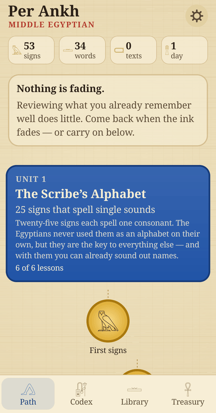 The path, unit by unit</td>
    <td align="center" width="25%">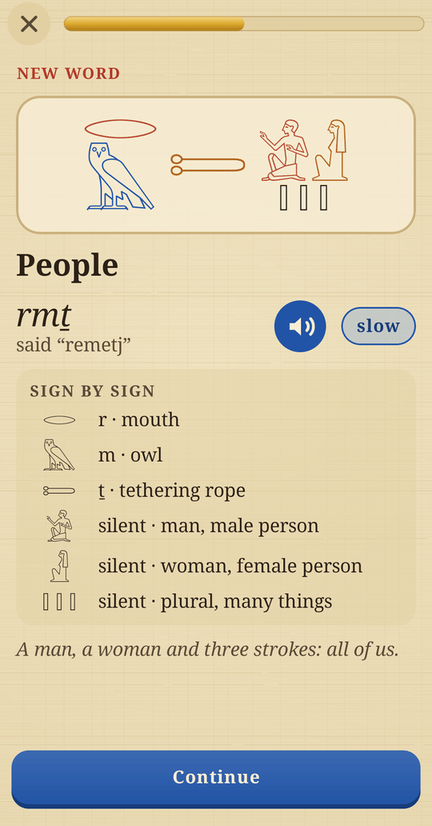 A new word, sign by sign</td>
    <td align="center" width="25%">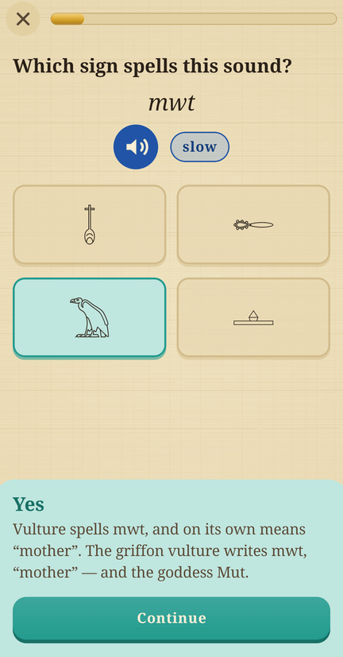 Which sign spells the sound?</td>
    <td align="center" width="25%">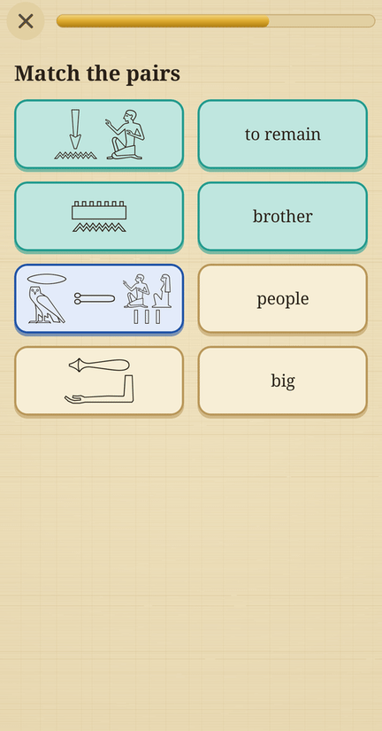 Matching pairs</td>
  </tr>
  <tr>
    <td align="center">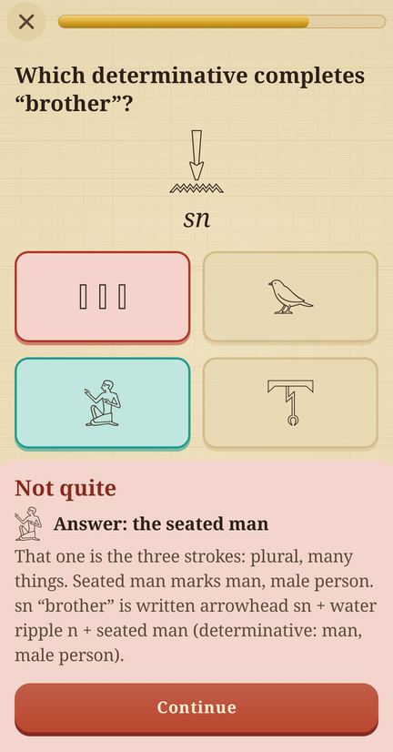 A mistake, explained</td>
    <td align="center">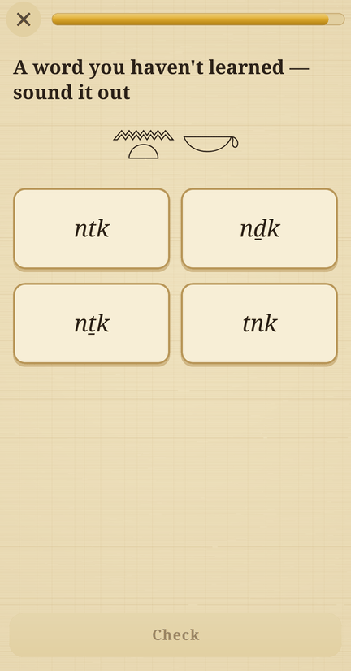 Sound out a word never taught</td>
    <td align="center">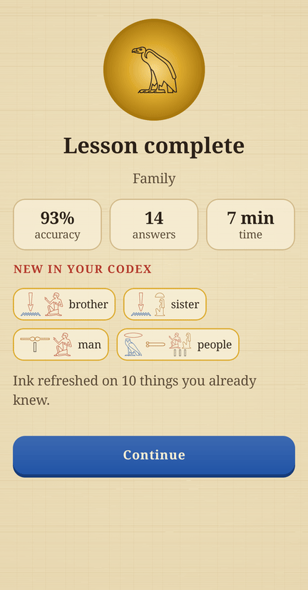 The lesson summary</td>
    <td align="center">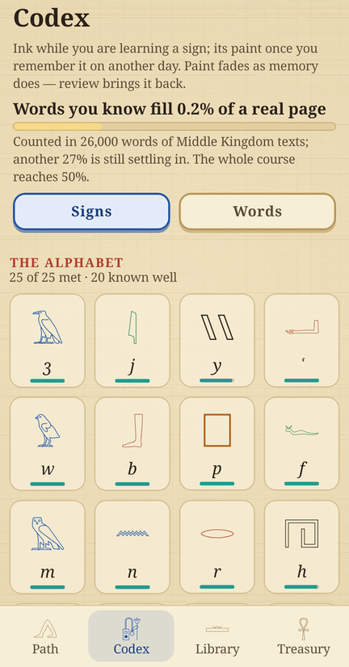 The codex: how much of a real page you can read</td>
  </tr>
  <tr>
    <td align="center">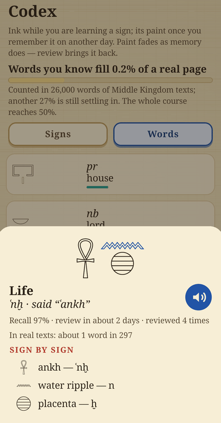 A word: how it is said, how common it is</td>
    <td align="center">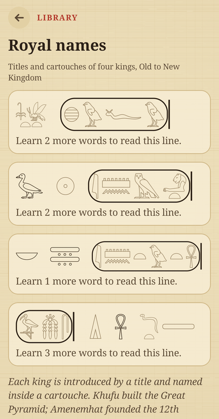 Real inscriptions in the library</td>
    <td align="center">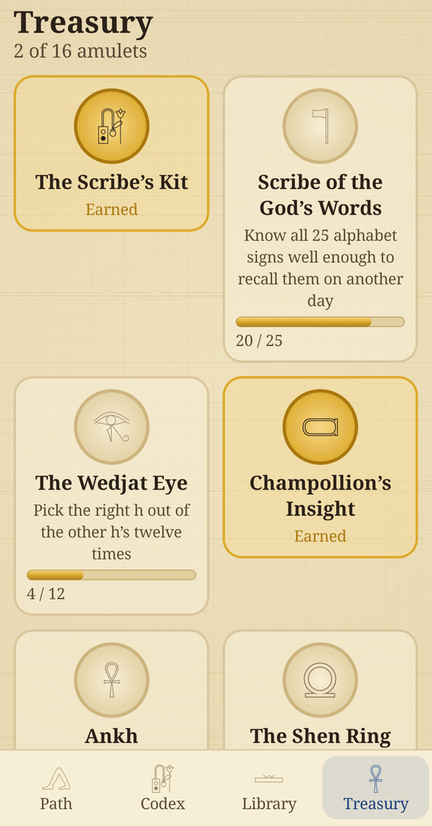 Amulets for abilities</td>
    <td align="center">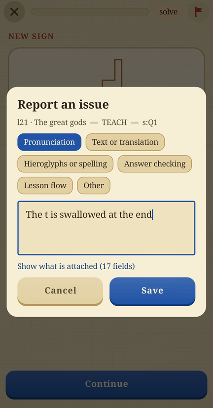 Tester mode: report what is on screen</td>
  </tr>
</table>

## What makes it not Duolingo

- **Memory, not streaks.** Every sign, word, phrase and idea has its own memory, modelled with
  FSRS (stability + difficulty, power-law forgetting). Items come back when recall is about to
  drop below 85% — not on a rota, and not when you obviously still know them.
- **Repeat, but not too much.** Same-day repetitions are capped by the scheduler
  (`Scheduler.SHORT_TERM_CEILING`): drilling an item ten times in one sitting cannot fake a month
  of memory. A wrong answer brings the item back three exercises later, at most twice per sitting.
- **Difficulty that climbs with the item.** Each exercise kind has a tier — recognise, recall,
  produce. An item moves up the ladder as its memory strengthens (never more than one rung above
  the hardest it has passed), and a struggling learner drops a tier while a cruising one gets
  stretched. Easy exercises earn less memory than hard ones (`Scheduler.tierWeight`).
- **Mistakes are allowed.** No hearts, no game over. Near misses — ḥ written as h, the right
  signs in the wrong order, a spelling missing only its determinative, ten strokes where a scribe
  would write a hobble — are recognised and named, not marked wrong.
- **Distractors that learn.** Wrong options are drawn from what you have actually met, sized like
  the answer, and weighted towards look-alikes and sound-alikes once an item is known. Any pair you
  confuse is recorded and keeps being offered side by side until you stop confusing it.
- **Transfer, not just recall.** "Sound it out" exercises show a word you were never taught, built
  only from signs you know — Champollion's method.
- **Progress that means something.** The path counts signs, words and *texts you can read*. The
  library shows real inscriptions with the words you know painted in. The codex fills with the
  colours of a tomb wall as you learn, and fades back to ink as memory fades, and says how much of
  a real page your words fill — word frequencies counted in the Thesaurus Linguae Aegyptiae's
  Middle Egyptian sentences (the whole course reaches 50%). Amulets mark abilities (telling the
  four h's apart, relearning what you forgot, reading the offering formula, knowing a quarter of
  every page), each with its own piece of Egyptian lore.
- **Sounds Egyptian really had.** Pronunciation follows the Egyptological convention, generated
  from the transliteration by `core-script` `Pronounce.kt`: e between consonants, and ḥ, ꜥ, ḫ, ẖ, q
  kept distinct (ptḥ is "peteḥ", not "Ptah"). A sign on its own is said as its sound: ꜣ and ꜥ as
  "a", j as "i", every other letter with a short e ("be", "he", "ḥe", "khe"). Clips are spoken by
  a native Arabic voice reading fully vowelled Arabic script, the one input that reliably produces
  those consonants.

## Tester mode

Settings → Testing → *Tester mode* puts a flag in the corner of every lesson page, Codex sheet and
reader. A report saves a category, a note and everything on screen — lesson, exercise, prompt,
options and accepted answers, the item's spelling, transliteration, respelling, IPA, the Arabic
text the voice was given and the clip file, the answer given and the verdict — one JSON line per
report in `/sdcard/Android/data/com.krbavcic.pentalingo/files/reports/reports.jsonl`. Pull it with
`adb pull` or share it from Settings. Two more switches: *Open any lesson* (start locked lessons)
and *Answer button* (a "solve" chip).

## Modules

| module | what |
|---|---|
| `core-script` | Gardiner sign table (generated from the font), Manuel de Codage parser, quadrat layout, transliteration |
| `core-model` | items, lessons, course, memory, progress, awards — pure Kotlin, serialisable |
| `core-engine` | FSRS scheduler, exercise factory, answer checker, session planner, recording, awards |
| `content` | the Middle Egyptian course: 9 units, 47 lessons, ~105 signs, 99 words, phrases, texts; word frequencies |
| `data` | `ProgressStore`: one JSON document in DataStore; `ReportStore`: tester reports |
| `core-ui` | papyrus, palette, hieroglyph renderer, painted buttons, audio, sound effects |
| `feature-path` / `feature-lesson` / `feature-codex` | the screens |
| `app` | activity and navigation |

Everything below `data` is plain JVM and tested without a device: `gradlew :core-script:test
:core-engine:test :content:test`. The content tests walk the whole course with a perfect learner
(every exercise must be answerable) and a careless one (nothing may get stuck).

## Tools

- `tools/gen_signs.py` — regenerates `signs.tsv` (Gardiner code → codepoint → ink box) from the
  bundled font, via Python's Unicode database.
- `tools/gen_sfx.py` — synthesises the harp sound effects (Karplus–Strong, pentatonic).
- `tools/voice.py` — records the pronunciation clips with ElevenLabs: Eleven v4, voice Chaouki (a
  native Modern Standard Arabic narrator), fed the Arabic-script rendering that `gradlew
  :content:run` exports to `tools/out/speech.json`. Each take is transcribed back by Scribe in
  Arabic (and English, for p) and passes only if every hard consonant (ḥ ꜥ ḫ q š ḏ) is heard; failing
  takes are retried with other seeds and spellings, and short words that still fail are said inside
  an Arabic frame ("qul: …") and cut out at the pause (needs ffmpeg). Takes are content-addressed,
  so nothing is billed twice; `rescore` re-judges them for free, `report` lists every clip with what
  was heard, and `prune` moves unused takes to `tools/out/takes`. The key comes from
  `$ELEVENLABS_API_KEY`, or from a file outside the repository (`$ELEVENLABS_KEY_FILE`, default
  `~/dev/11labs/.env`), read by path and never stored here.
- `tools/tla.py` — counts lemma frequencies in the Thesaurus Linguae Aegyptiae's Earlier Egyptian
  corpus (download it to `tools/out/tla/`; run with `python -I`), reports how much of real Middle
  Egyptian the course's words cover and which frequent words it lacks, and with `--write`
  regenerates `content/.../Frequency.kt`.

## Licences

Noto Sans Egyptian Hieroglyphs and Noto Serif: © Google, SIL Open Font License 1.1 (the licence
is embedded in each font file's name table). Course content written for this project. Word
frequencies in `Frequency.kt` are derived from the Thesaurus Linguae Aegyptiae (BBAW / SAW
Leipzig), Earlier Egyptian corpus v18, CC BY-SA 4.0, and are shared under the same licence.
